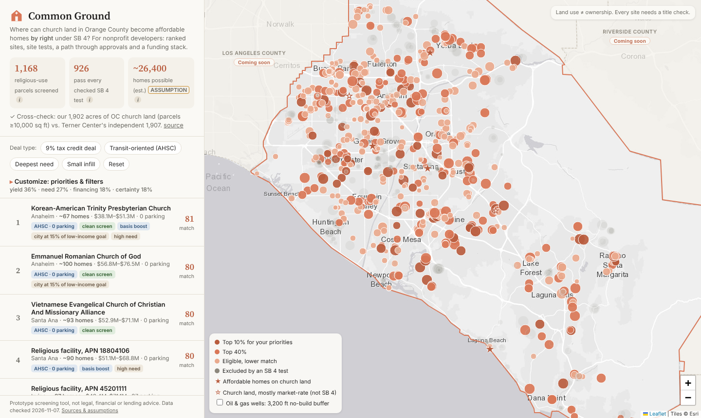
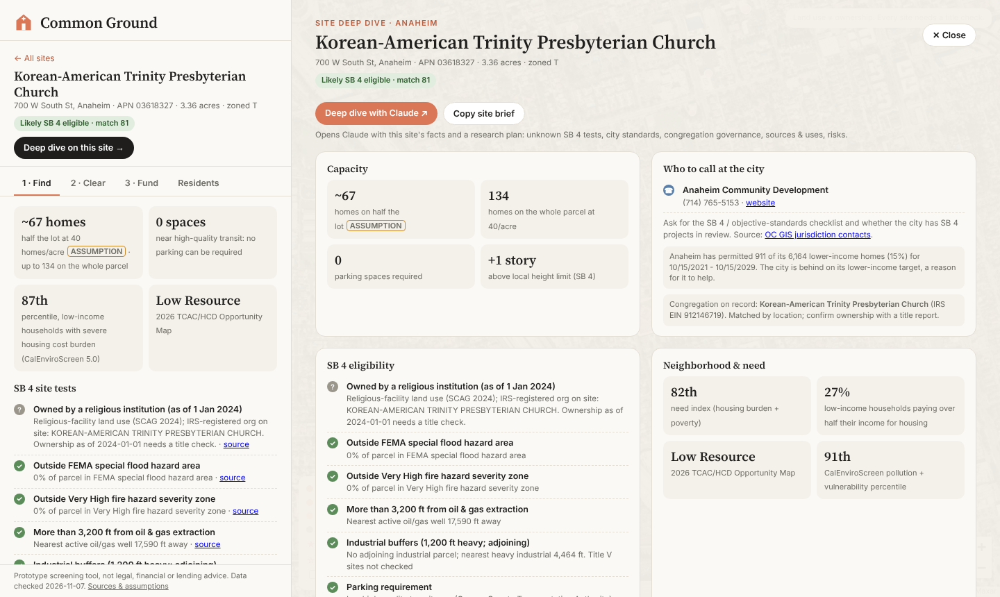

# Common Ground: SB 4 church-land finder for Orange County

> For nonprofit affordable-housing developers: every church parcel in Orange County screened against SB 4 ("Yes in God's Backyard"), ranked by what the developer cares about, with a path through approvals, a sourced cost estimate, a capital stack and a one-click deep dive.

**Team:** Common Ground
**Members:** Max Garcia, Tyler
**Lane:** 1 Find it (with Clear it and Fund it panels for each site)
**Built at:** Claude Impact Lab: UCI × SoCal Affordable Housing, November 7, 2026

> Prototype screening tool. Not legal, financial or lending advice. Land use is not ownership: every site needs a title check.



## The real user

_Made-up user, per the event rules._ The acquisitions lead at a small Orange County nonprofit developer. Sites come by luck: a pastor calls, or a city mentions a lot. SB 4 (2023) made housing legal by right on almost every church property, but nobody has mapped which ones qualify, how many homes fit, or whether a deal would pencil.

**Before:** drive around, call churches cold, pay a consultant to check zoning and hazards one parcel at a time, guess at cost and funding.
**After:** open the map, pick a deal type (9% tax credit, transit-oriented, deepest need, small infill), get a ranked list of eligible church parcels with homes, cost, parking and funding fit, then open a deep dive with the city contact, the congregation on record, the SB 4 checklist, a capital stack and next steps.

## What we built

- **Countywide screen.** 1,168 parcels that SCAG's 2024 land-use data classes as religious facilities, across all 34 OC cities. 926 pass every SB 4 test we can check; 242 are excluded (heavy industry within 1,200 ft: 130, Very High fire zone: 52, FEMA flood zone: 43, active oil/gas well within 3,200 ft: 31). About 26,400 homes are possible on half of each eligible lot of 0.5+ acres (ASSUMPTION, see below).
- **Cross-check.** Our 1,902 acres of OC church land (parcels ≥ 10,000 sq ft) match Terner Center's independent 1,907-acre estimate ([Terner-Center/SB4-Analysis](https://github.com/Terner-Center/SB4-Analysis)).
- **Nonprofit profile.** A developer enters who they house (families, seniors, supportive housing, workforce), deal size, the largest project they can take on, how they finance (4%/9%/no tax credits), priorities, whether they can build structured parking, risk tolerance and service-area cities. The profile becomes ranking weights and filters, and every site shows **why it fits** that organization (e.g. "near frequent transit · no garage needed · high need · in your service area"). Saved only in the user's browser; it also feeds the Claude deep-dive prompt.
- **Deal screening.** Presets (9% tax credit deal, Transit-oriented/AHSC, Deepest need, Small infill), four priority sliders (yield, community need, financing fit, entitlement certainty) and filters (homes, total cost, no-parking, need index, 9%-competitive area, AHSC-eligible, HUD basis boost, clean screen, city behind on its lower-income target, already in the housing element, contactable congregation, city). Every control has a tooltip with its exact method.
- **Per site, three tabs:**
  1. **Find:** every SB 4 test as pass / fail / caution / unknown with its source; capacity; parking; need; opportunity area; city housing-target progress; basis-boost eligibility.
  2. **Clear:** ministerial path vs. typical rezoning, review clock, clearance checklist, draft intro letter to the congregation (draft only, never sent).
  3. **Fund:** line-item total development cost, an illustrative three-layer capital stack for a 9% and a 4% deal, and program fit for eight funding sources with reasons for this site.
- **Congregation contact** on every site: public phone, website and office email from Overture Maps business listings (941 of 1,168 parcels have a phone), shown in the site header, the deep dive and the draft letter.
- **Deep dive** on any site: city Community Development contact, congregation contact and IRS record, full eligibility list, need, cost, financing, nearest church-housing precedents, other candidate sites within a mile, next steps, and **"Deep dive with Claude"**, which opens Claude with the site's facts and a research plan.
- **Precedents on the map:** Legacy Square (Santa Ana, 93 homes), Wesley Village (Garden Grove, 47), 340 St. Ann's Drive (Laguna Beach, 29, SB 4), Church of the Blessed Sacrament (Placentia, 65), plus two mostly market-rate church-land projects for contrast.
- Neighboring counties are shown as "coming soon": the pipeline is county-agnostic (SCAG covers six counties).



**Demo video:** uploaded on the hub
**Live demo:** see "Try it" (static page; a hosted copy is available on request)

## How Claude is used

- **Built with Claude.** Claude (Claude Code) found and tested the data sources, wrote the data pipeline and the web app, checked numbers against sources, and drafted this README. A separate Claude review of the financing logic caught a double-counted prevailing-wage cost and a missing 9% credit cap, which we fixed.
- **Inside the tool.** "Deep dive with Claude" opens Claude with the site's computed facts and asks it to verify the tests we cannot check, find the city's objective standards, look up the congregation's governance, sketch sources and uses, and list risks, with citations. A person checks every claim before acting. The intro letter is a draft for a person to edit and send.

## Try it

Needs Python 3.11+ and a browser. The scored data for every site is committed (`web/data/sites.js`), so the app runs without any accounts or keys.

```bash
git clone https://github.com/Max-Garcia-06/socal-housing-finder
cd socal-housing-finder/web
python3 -m http.server 8765
# open http://localhost:8765
```

To rebuild the data from the public sources (about 2 minutes; needs [uv](https://docs.astral.sh/uv/)):

```bash
uv sync
uv run python scripts/fetch_layers.py      # downloads public layers to data/raw/ (cached, gitignored)
uv run python scripts/build_sites.py       # screens and scores every parcel -> web/data/sites.js
uv run python scripts/make_standalone.py   # optional: single-file copy in dist/ (draws city outlines instead of map tiles)
```

No API keys are used. `.env.example` lists only the optional Census key for the older `findit` helpers.

## How the screen works

| Step | Method | Source |
|---|---|---|
| Candidate parcels | SCAG existing land use 2024, code 1245 "Religious Facilities" | [SCAG Existinglanduse_poly_OR](https://maps.scag.ca.gov/scaggis/rest/services/LDX/Existinglanduse_poly_OR/MapServer) |
| Zoning | SCAG zoning by APN; SCAG category 11xx treated as residential | [SCAG Zoning_poly_OR](https://maps.scag.ca.gov/scaggis/rest/services/LDX/Zoning_poly_OR/MapServer) |
| Flood | FEMA special flood hazard area, county DFIRM copy: fail if > 50% of parcel, caution if > 2% | [OC Floodplains](https://www.ocgis.com/arcpub/rest/services/Map_Layers/Floodplains/MapServer/0) |
| Fire | CAL FIRE Very High FHSZ, LRA (county copy) and SRA: same thresholds | [OC FHSZ LRA](https://www.ocgis.com/arcpub/rest/services/Map_Layers/Fire_Hazard_Severity_Zones_LRA/MapServer/0), [CAL FIRE](https://services.gis.ca.gov/arcgis/rest/services/Environment/Fire_Severity_Zones/MapServer) |
| Oil and gas | Fail if an active/new well is within 3,200 ft; caution if an idle well is | [CalGEM WellSTAR](https://gis.conservation.ca.gov/server/rest/services/WellSTAR/Wells/MapServer/0) |
| Industry | Fail if a SCAG heavy-industrial (132x) parcel is within 1,200 ft; caution if the parcel adjoins any industrial parcel (13xx). Title V sites not checked | SCAG existing land use |
| Parking | Center inside a Caltrans High Quality Transit Area → no parking can be required; otherwise up to 1/home | [Caltrans HQTA](https://caltrans-gis.dot.ca.gov/arcgis/rest/services/CHrailroad/CA_HQ_Transit_Areas/FeatureServer/0) |
| Not checked (shown as "unknown") | Earthquake fault zones (CGS service needs a token), wetlands/habitat/farmland, historic structures, existing tenants, ownership as of 1 Jan 2024 | |
| Names | IRS-registered places of worship within 75 m of the parcel (a lead, not proof of ownership) | [HIFLD All Places of Worship (IRS EO BMF)](https://services.arcgis.com/XG15cJAlne2vxtgt/arcgis/rest/services/All_Places_Of_Worship__HiFLD_Open_/FeatureServer) |
| Capacity | Acres × 50% buildable (ASSUMPTION) × SB 4 density: 30/acre residential (20 in HCD "suburban" cities: La Palma, Laguna Beach, Laguna Woods, Los Alamitos, Villa Park), 40/acre non-residential | [HCD SB 4 fact sheet](https://www.hcd.ca.gov/sites/default/files/docs/planning-and-community/aff-hsg-faith-higher-ed-sb-4.pdf), [HCD default densities](https://www.hcd.ca.gov/community-development/housing-element/housing-element-memos/docs/defaultdensity2020censusupdate.pdf) |
| Need index | Average of CalEnviroScreen 5.0 tract percentiles for housing burden and poverty | [CalEnviroScreen 5.0](https://services1.arcgis.com/PCHfdHz4GlDNAhBb/arcgis/rest/services/calenviroscreen50results_F_070126_gdb/FeatureServer/2) |
| Financing fit | Half: tract High/Highest Resource on the 2026 TCAC/HCD map. Half: in a high-quality transit area | [TCAC/HCD 2026 Opportunity Map](https://www.treasurer.ca.gov/ctcac/opportunity.asp) |
| Entitlement certainty | 100 minus 15 per caution, minus 50 for slope class > 15 | |
| Match score | Weighted average of yield (percentile of homes, capped at 150), need, financing fit, certainty, using the user's slider weights. Only likely-eligible parcels of 0.5+ acres are ranked (ASSUMPTION) | |

## How we estimate cost and financing

**Total development cost** = homes × 850 rentable sq ft (ASSUMPTION; Legacy Square units are 602–1,115 sq ft) × $481–$625 per sq ft × 1.39–1.44, plus a garage for required parking in the high case. That is about **$568k–$765k per home**.

| Input | Value | Source |
|---|---|---|
| All-in tax-credit cost per rentable sq ft (2019 dollars) | $481 San Diego metro; LA metro ≈ 1.3× ($625; ASSUMPTION that OC prices like LA) | RAND, *The High Cost of Producing Multifamily Housing in California* (2025) |
| Escalation 2019 → 2024 | +39% statewide, +44% LA (2025–26 not added) | Verisk via [Construction Owners, Mar 2025](https://www.constructionowners.com/news/la-construction-costs-up-5-9-adding-challenges-to-fire-rebuilding) |
| Hard / soft split | ~60% / ~40% | Terner Center: hard costs > 60% of CA totals |
| City impact fees (inside soft costs) | ~$29k/home | RAND 2025 |
| Prevailing wage (SB 4 requires it) | Not added separately: already in RAND's tax-credit benchmark. Terner puts the PW gap at ~$94k/home | [Terner 2024](https://ternercenter.berkeley.edu/research-and-policy/lihtc-construction-costs-prevailing-wages/) |
| Structured parking (high case, outside transit areas) | $52k/space | [UCLA ITS 2025](https://its.ucla.edu/?p=95739) |
| Land | $0: congregation ground-leases (Legacy Square, Wesley Village did) | |
| Cross-checks | Terner: CA tax-credit applications paying prevailing wage averaged $726k/home (2024 dollars). Wesley Village: ~$18.9M for 47 homes in 2017 | [Terner 2024 PDF, note 15](https://ternercenter.berkeley.edu/wp-content/uploads/2024/08/Low-Income-Housing-Tax-Credit-Construction-Costs-An-Analysis-of-Prevailing-Wages-August-2024.pdf) |

**Capital stack (illustrative, on the midpoint cost):**
- **9% deal:** tax-credit equity ≈ 70% of cost (ASSUMPTION: typical program share), **capped** at TCAC's per-project limit of $2.5M/yr federal credits × 10 years × ~$0.90/credit (ASSUMPTION) ≈ $22.5M ([TCAC reg. §10305(e)](https://www.treasurer.ca.gov/ctcac/meeting/staff/2009/20090225/4.pdf); confirm the current figure). Permanent loan 25% (ASSUMPTION). Soft money fills the rest.
- **4% + bond deal:** patterned on Wesley Village's actual financing: ~39% tax-credit equity ($7.45M), ~25% permanent loan ($4.8M), ~36% soft money (incl. $3.6M HOME, $460k AHP) ([source](https://www.multifamilybiz.com/news/7870/jamboree_housing_works_to_solve_affordable_housing)). From 2026 the bond test is 25% instead of 50% and CTCAC has $500M of state credits for 4% new construction ([CTCAC 2026](https://www.treasurer.ca.gov/ctcac/2026/2026-credit-estimates.pdf)).
- Not modeled: California state credits, the 130% QCT/DDA basis boost (flagged per site), loan sizing from actual rents.

## Sources and assumptions

| Item | Source or assumption | Date checked |
|---|---|---|
| SB 4 rules | HCD fact sheet (Apr 2026); ABAG SB 4 deck (Mar 2026) | 2026-11-07 |
| Religious parcels, zoning, industry, housing-element sites | SCAG LDX services (2024 land use and zoning; 6th-cycle HE sites) | 2026-11-07 |
| Flood, fire, oil/gas, transit | OC GIS (FEMA DFIRM copy, LRA FHSZ), CAL FIRE SRA FHSZ, CalGEM WellSTAR, Caltrans HQTA | 2026-11-07 |
| Need, opportunity | CalEnviroScreen 5.0; TCAC/HCD 2026 Opportunity Map shapefile | 2026-11-07 |
| Basis boost | HUD eGIS Qualified Census Tracts and Small Area DDAs (services named "2026"; confirm designation year) | 2026-11-07 |
| City targets | HCD 6th-cycle RHNA progress report, data.ca.gov | 2026-11-07 |
| Income limits | HCD 2026 State Income Limits, Orange County (AMI $138,600 for 4) | 2026-11-07 |
| City contacts | OC GIS Jurisdiction Contacts (public Community Development offices) | 2026-11-07 |
| Congregation contacts | Overture Maps places, release 2026-10-21.0 (CDLA-Permissive-2.0): public phone, website and role emails (office@, info@ …) for places of worship within 60 m of the parcel; personal-looking emails dropped. 941 of 1,168 parcels have a phone | 2026-11-07 |
| Church names | HIFLD All Places of Worship (IRS Exempt Organizations BMF) | 2026-11-07 |
| Precedents | National CORE, Jamboree, Laguna Beach Indy/City, HCD APR Table A (`data/reference/apr_oc_church_projects.csv`) | 2026-11-07 |
| Benchmark | Terner Center SB4-Analysis county tables | 2026-11-07 |
| County outlines / city outlines | Census cartographic boundaries 2023; OC GIS City Boundaries | 2026-11-07 |
| 50% of lot buildable | ASSUMPTION: sanctuary and some parking stay | |
| 0.5-acre minimum to rank | ASSUMPTION: smaller lots rarely pencil for a nonprofit rental | |
| 850 rentable sq ft per home | ASSUMPTION | |
| OC priced like RAND's LA metro | ASSUMPTION | |
| 9% equity share 70%, $0.90 credit price, 25% loan | ASSUMPTION | |
| 50+ homes for a bond deal; preset home ranges | ASSUMPTION (judgment, not TCAC rules) | |

## What is real and what is mocked

| Part | Status |
|---|---|
| Countywide parcel screen (flood, fire, oil/gas, industry, parking) | working, real public data |
| Ranking, presets, filters, tooltips, nonprofit profile | working (profile stored only in the browser) |
| Cost estimate and capital stack | working; benchmark-based, not an underwriting |
| Program fit | working; rules of thumb from public program criteria |
| City contacts, RHNA progress, income limits, basis-boost flags | working, real public data |
| Ownership confirmation | not possible from free data; proxy only |
| Fault zones, wetlands, historic, tenants, Title V | not checked; shown as "unknown" |
| Intro letter and Claude deep-dive prompt | drafts; nothing is sent |

## Where it gets things wrong

- **Land use is not ownership.** SCAG's "religious facility" code and an IRS-registered org nearby are leads. SB 4 needs ownership as of 1 Jan 2024; only a title report confirms it. Some church land coded otherwise (a school, a parking lot) is missed.
- **Capacity is a rough screen.** Half the lot at base density ignores density bonus law and the extra story, and assumes the rest of the site stays in church use. Check: the Laguna Beach SB 4 project proposes 29 homes on its 0.85-acre parcel; we estimate 17 (half the lot) to 34 (whole parcel).
- **Zoning category is coarse.** SCAG's regional category decides 30 vs 40 homes/acre; specific-plan and institutional zones may be misread.
- **The industry test is strict.** SCAG's heavy-industrial category stands in for SB 4's definition and excludes 130 sites; some may be fine.
- **Costs are regional averages**, not site estimates; soil, podium vs. wood frame, and unit mix change them a lot.
- **Transit areas are straight-line polygons**, not SB 4's ½-mile walking distance.

## Next steps

For a nonprofit to use it next month: add Assessor ownership (paid roll or title partner) and CGS fault zones; let users mark sites as contacted / passed; export a site memo; check each city's objective standards. With one more week: the other five SCAG counties, a rent-based loan sizing using the income limits already loaded, and the Surplus Land Act notices as a second land source.

## Data and privacy

This project uses only public or provided data. It contains no personal information about real tenants, buyers or residents. Congregations appear as organizations from the IRS exempt-organizations list. Contact details are organizations' public business listings (Overture Maps); only role-based emails (office@, info@) are kept and emails that look like a person's are dropped. City contacts are public office numbers. It does not file applications or contact any city or person.

## Code

| Path | What |
|---|---|
| `scripts/fetch_layers.py` | Downloads every public layer (paged, cached) |
| `scripts/build_sites.py` | Screens, scores and prices every parcel → `web/data/sites.js` |
| `scripts/make_standalone.py` | Single-file build for hosting without map tiles |
| `web/index.html` | The app (Leaflet, no build step) |
| `findit/` | Earlier geo / Census helpers (adapted from our UCI Datathon project with Justin Siek, Austin H and Leo Wu-Hacohen) |
| `video/film.py`, `video/voiceover.py` | Record the demo video from the live page and add the narrated voiceover (Edge neural TTS, `pip install edge-tts`) |

## License

MIT, see [LICENSE](LICENSE).
